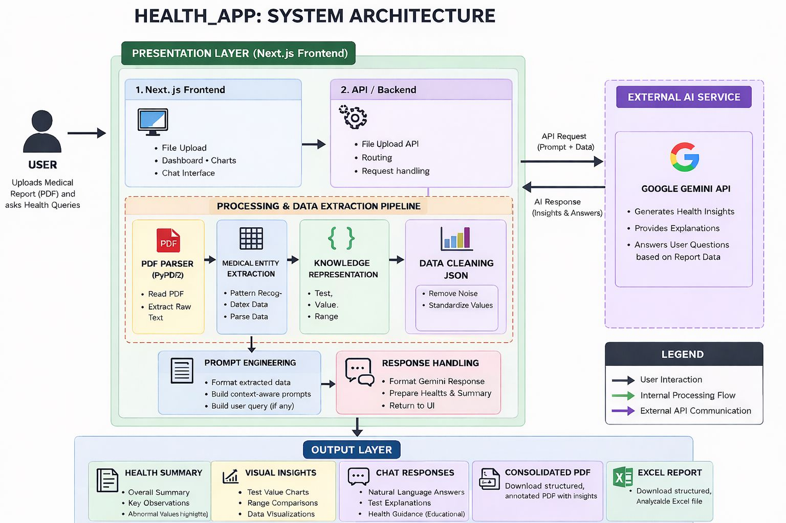

# Medical Report Analyzer

Production URL: https://health-app-lovat-eta.vercel.app/

## 1) What Is This?

Medical Report Analyzer helps families and caregivers organize medical reports that are usually scattered across PDFs, labs, and timelines. Instead of treating each report as a one-off file, it builds a longitudinal health history with normalized test names and values, then adds an AI clinical assistant to explain trends and answer report-specific questions.

## 2) Important Disclaimers

- This project is for informational support and engineering research.
- Clinical assistant outputs are not medical diagnosis, treatment, or professional advice.
- Extraction quality depends on source PDF text quality, OCR quality, and lab formatting.
- Reference ranges vary by lab and report context; human review is required.

## 3) Features

- Upload multiple lab reports at once and optionally merge with existing Excel/CSV data.
- Extract medical findings from PDFs into a structured record.
- Normalize noisy test names, categories, and statuses across report formats.
- Track results over time using profile and study timelines.
- Ask a clinical assistant questions answered from your own results, with cited guideline extracts.
- View trend charts and report summaries for faster interpretation.
- Export structured insights to PDF and Excel.
- Use secure login with Firebase token verification in backend APIs.

## 4) System Architecture



## 5) Tech Stack

- Frontend: Next.js 15, React 19, TypeScript, Tailwind-compatible styling.
- Backend: FastAPI, Python 3.11+, SQLAlchemy-based data layer.
- Auth: Firebase Authentication + Firebase Admin token verification.
- Database: PostgreSQL with JSONB payload storage for report analysis.
- AI: Google Gemini API for extraction, chat, and insight generation.
- Deployment: Vercel (frontend), Hugging Face Docker Space (backend), Neon (database).

## 6) Getting Started / Local Development

### 6.1 Prerequisites

- Node.js 18+
- Python 3.11+
- PostgreSQL
- Firebase project and service account
- Gemini API key

### 6.2 Setup

```bash
git clone <repo-url>
cd Medical_Project

python3 -m venv .venv
source .venv/bin/activate
pip install -r requirements.txt

cd web
npm ci
cd ..

cp .env.example .env
cp web/.env.example web/.env.local
cp backend_api/.env.example backend_api/.env
```

### 6.3 Run Locally

Recommended:

```bash
./start.sh
```

Manual:

```bash
# backend
source .venv/bin/activate
uvicorn backend_api.app.main:app --reload --port 8000

# frontend
cd web
npm run dev
```

Logs:

```bash
./logs.sh backend
./logs.sh frontend
./logs.sh follow-backend
```

Stop services:

```bash
./stop.sh
```

## 7) Environment Variables

Environment templates are provided in:

- .env.example
- web/.env.example
- backend_api/.env.example

Critical variables you must set:

- GEMINI_API_KEY: Get this from Google AI Studio.
- DATABASE_URL: PostgreSQL connection string (local DB, Supabase, Neon, etc.).
- Firebase credentials:
  - Frontend NEXT_PUBLIC_FIREBASE_* values from Firebase Console -> Project Settings -> Your apps.
  - Backend FIREBASE_CREDENTIALS_PATH points to a Firebase Admin service account JSON downloaded from Firebase Console -> Project Settings -> Service Accounts.

Most important runtime variables by layer:

- Frontend
  - NEXT_PUBLIC_API_URL
  - NEXT_PUBLIC_API_BASE_URL
  - NEXT_PUBLIC_DIRECT_API_URL
  - NEXT_PUBLIC_FIREBASE_API_KEY
  - NEXT_PUBLIC_FIREBASE_AUTH_DOMAIN
  - NEXT_PUBLIC_FIREBASE_PROJECT_ID
  - NEXT_PUBLIC_FIREBASE_STORAGE_BUCKET
  - NEXT_PUBLIC_FIREBASE_MESSAGING_SENDER_ID
  - NEXT_PUBLIC_FIREBASE_APP_ID
- Backend
  - DATABASE_URL
  - GEMINI_API_KEY
  - API_CORS_ORIGINS
  - FIREBASE_PROJECT_ID
  - FIREBASE_CREDENTIALS_PATH or FIREBASE_SERVICE_ACCOUNT_JSON
  - FIREBASE_CLOCK_SKEW_SECONDS
  - MAX_UPLOAD_FILES, MAX_UPLOAD_FILE_MB, MAX_UPLOAD_TOTAL_MB
  - RATE_LIMIT_PER_MINUTE

## 8) Backend API Reference

Implemented FastAPI route groups under /api/v1:

- Auth
  - GET /auth/me
  - POST /auth/sync
- Profile and study management
  - GET /studies/profiles
  - POST /studies/profiles
  - GET /studies/profiles/{profile_id}/studies
  - POST /studies
  - GET /studies/dashboard
  - GET /studies/{study_id}/combined-report
  - GET /studies/profiles/{profile_id}/trends?test=
- Report analysis and history
  - POST /reports/jobs
  - GET /reports/jobs/{job_id}
  - GET /reports/history
  - GET /reports/history/{analysis_id}
- Clinical and export
  - POST /reports/chat
  - POST /reports/export/pdf
  - POST /reports/export/excel
- Utility
  - GET /health

## 9) Frontend Architecture

Frontend framework:

- Next.js 15 + React 19 + TypeScript App Router.
- Global auth provider in web/app/layout.tsx.
- Route protection via middleware cookie gate plus backend token validation.

Major frontend modules:

- Authentication
  - web/lib/auth-context.tsx
  - Firebase sign-in (Google + email/password), token provider wiring, backend sync.
- Dashboard and workflows
  - web/app/dashboard/page.tsx
  - Study flow modal, uploads with job polling, history retrieval.
- Visual components
  - TrendChart, AlertsByCategory, OrganizedDataTree, ClinicalChatPanel.

## 10) Data Model

Main relational entities (PostgreSQL):

- users: Firebase identity mapping and login metadata.
- report_analyses: saved analysis history snapshots.
- profiles: patient profiles under account owner.
- studies: logical longitudinal groups under profile.
- reports: uploaded report instances per study with the raw analysis_data (JSONB).
- report_findings: one row per measured value; trends, dashboard alerts and the
  combined report read from here.
- report_jobs: one row per upload being analysed; the browser polls it.

Schema assets:

- backend_api/migrations/ (Alembic), applied by the API at startup.

## 11) Ingestion Pipeline

### 11.1 Upload and orchestration

- Frontend posts the multipart upload to POST /api/v1/reports/jobs and gets a
  job id back at once.
- A worker pool analyses the files and saves the result server-side, into the
  chosen study or into history.
- The browser polls GET /api/v1/reports/jobs/{id}; the job carries per-file
  progress (queued, extracting, parsing, done, failed) and a stage
  (processing, saving, done). A refresh resumes the same job.
- Jobs in flight when the server restarts are marked interrupted with a
  message asking for a re-upload.

### 11.2 PDF extraction and LLM parsing

Backend service path:

- Extract raw text from PDF bytes using extract_text_from_pdf.
- Call Gemini extraction workflow through analyze_medical_report_with_gemini.
- Transform LLM output into tabular records via create_structured_dataframe.
- Merge optional existing CSV/XLSX data via process_existing_excel_csv.
- Consolidate patient identity and demographics across reports.

Core implementation:

- backend_api/app/services.py (orchestration)
- backend_api/app/extraction.py (PDF text, OCR, model prompt, validation)
- backend_api/app/values.py (results, ranges, statuses, dates)
- backend_api/app/patients.py, insights.py, exports.py, chat.py

### 11.3 Normalization and data engineering

- Parse numeric values and dates.
- Normalize categories and test names to canonical forms.
- Resolve aliases and reduce semantic duplicates.
- Recompute health summary and body-system aggregations from normalized records.

Normalization entry points:

- backend_api/app/normalization.py
- backend_api/app/findings.py
- backend_api/scripts/backfill_findings.py

## 12) Clinical Assistant

Clinical assistant flow:

- The browser sends the question, recent history and a study or saved-analysis id to /api/v1/reports/chat.
- The backend loads that study's findings (or the saved analysis) after checking the caller owns it.
- It picks up to three guideline extracts by whole-word matches on the question and on results outside range.
- The prompt puts the newest results and the abnormal ones first, and marks report text as data, not instructions.
- A rate-limited or timed-out model returns 429 or 503, never an error message disguised as an answer.

Code:

- backend_api/app/chat.py (prompt and model call)
- backend_api/app/guidelines.py and backend_api/app/data/guidelines.json (18 guideline extracts)

## 13) Security

Authentication model:

- Firebase issues client ID tokens.
- Frontend sends Authorization: Bearer <token> for protected requests.
- Backend verifies token with Firebase Admin SDK and validates project/audience.

Security controls:

- CORS allowlist controlled by API_CORS_ORIGINS.
- Auth-required endpoints reject missing or invalid tokens.
- Clock-skew tolerant token verification via FIREBASE_CLOCK_SKEW_SECONDS.
- Middleware redirects unauthenticated users to /login.

## 14) Deployment

Live frontend:

- https://health-app-lovat-eta.vercel.app/

Repository deployment paths:

- Frontend hosting
  - Vercel with web/ as project root.
  - Configured by web/vercel.json and deploy/deploy_frontend_vercel.sh.
- Backend hosting
  - Hugging Face Space (Docker SDK) built from the root Dockerfile on push.
  - Keep the free Space awake with an uptime monitor on /health; see deploy/README.md.
- Database
  - PostgreSQL-compatible environments (Supabase/Neon patterns included).
  - Migration and verification scripts in deploy/.

Additional runbook:

- PRODUCTION_DEPLOYMENT_VERCEL_FIREBASE.md

## 15) Testing

Every pull request runs lint, typecheck and both test suites via GitHub Actions
(`.github/workflows/ci.yml`). To run them locally:

```bash
# backend and shared Python code
pytest
ruff check .

# the same tests against a throwaway Postgres database (CI runs both)
createdb health_tests
TEST_DATABASE_URL=postgresql://localhost/health_tests pytest

# frontend
cd web
npm run typecheck
npm run test
npm run lint
```

Optional metric-log test prerequisite:

```bash
export METRICS_TEST_TOKEN="<firebase-id-token>"
```

Operational smoke check:

```bash
BACKEND_URL="https://your-backend" \
FRONTEND_URL="https://your-frontend" \
./deploy/smoke_test.sh
```

## 16) Contributing

Pull requests are welcome. For major changes, open an issue first to discuss what you would like to change.

Areas where contributions are especially welcome:

- Better OCR handling for scanned PDFs.
- Support for more lab report formats.
- Mobile-friendly frontend improvements.

## 18) License
MIT License

